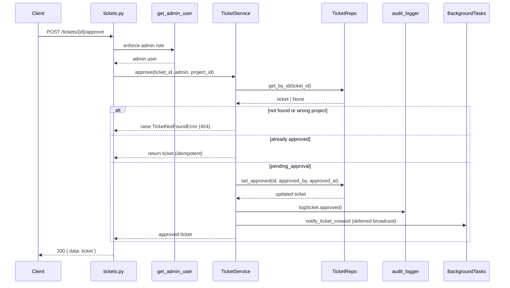
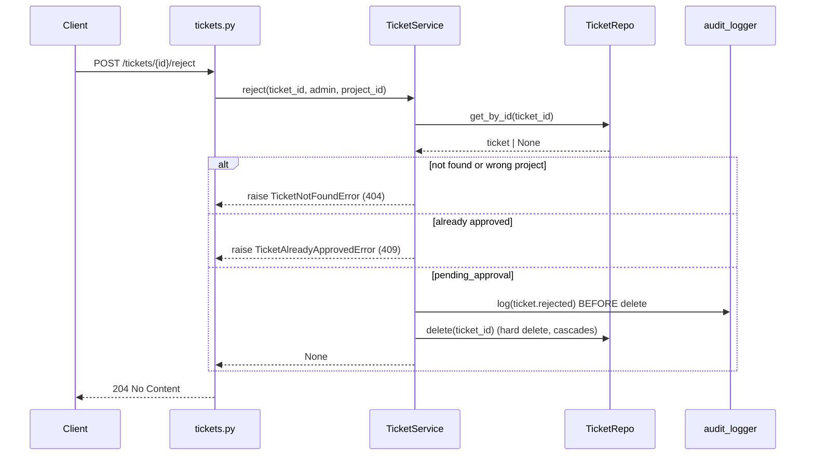

# Design Document: Ticket Approval Gate

## Overview

This feature adds an admin approval gate to ticket creation. A new ticket is
held in a `pending_approval` state, visible only to its creator and to admins.
An admin **approves** it (making it visible to everyone who can see the project)
or **rejects** it (hard-deleting it, after writing an audit record).

The design introduces a new ticket field, `approval_status`, that is
**orthogonal** to the existing work-lifecycle `status`. The existing `status`
column (`pending → in_progress → paused → in_review → completed`) is left
untouched; approval is a separate dimension. This avoids overloading the
`pending` work status, which already means "newly created, not yet worked on."

**Key design decisions:**

- **New column, not an overloaded status** — `approval_status` with values
  `pending_approval` and `approved`. Rejected tickets are deleted, so no
  `rejected` value is ever persisted.
- **No organization/tenant layer** — "everyone" means the existing project
  Visible_Audience. Visibility continues to be enforced at the application
  layer (the backend uses the Supabase `service_role` key, which bypasses RLS,
  per `migrations/001_initial_schema.sql`).
- **Visibility filtering lives in the service/repository read paths** — because
  there is no per-user ticket scoping today, we add a single predicate
  (`approval_status = 'approved' OR created_by = :viewer`) that is bypassed for
  admins. This is applied to list, search, detail, and aggregation reads.
- **Deferred notifications** — the "new ticket" broadcast is moved from creation
  to approval, so unapproved tickets never leak via email. Creation sends only a
  creator confirmation and an "awaiting approval" nudge to admins.
- **Reject is a hard delete** — reusing the existing hard-delete path, but with a
  dedicated `ticket.rejected` audit event written *before* the row is removed.
- **Backward compatible** — the migration backfills existing rows to `approved`
  so no historical ticket is retroactively hidden.

## Architecture

The feature follows the existing layered architecture
(endpoint → service → repository → Supabase):

```
Endpoint (api/v1/endpoints/tickets.py)
  ├── POST   /tickets                      (create — now sets pending_approval)
  ├── GET    /tickets                      (list — now approval-filtered)
  ├── GET    /tickets/{id}                 (detail — now approval-filtered)
  ├── GET    /tickets/pending-approval     (NEW — admin-only approval queue)
  ├── POST   /tickets/{id}/approve         (NEW — admin-only)
  └── POST   /tickets/{id}/reject          (NEW — admin-only, hard delete)
         │
         ▼
Service (services/ticket_service.py :: TicketService)
  ├── create()            → sets approval_status='pending_approval', defers broadcast
  ├── get_by_id()         → + viewer-aware visibility check
  ├── list_by_project()   → + viewer-aware approval filter
  ├── list_pending()      → NEW (admin queue)
  ├── approve()           → NEW (set approved, approver, timestamp, notify, audit)
  └── reject()            → NEW (audit THEN hard delete)
         │
         ▼
Repository (db/repositories/ticket_repo.py :: TicketRepo)
  ├── list_by_project()   → + optional approval predicate (approved OR created_by)
  ├── list_pending()      → NEW (eq approval_status = 'pending_approval')
  ├── search_fulltext()   → + optional approval predicate
  └── set_approved()      → NEW (write approval_status/approved_by/approved_at)
         │
         ▼
Supabase (tickets table — new columns via migrations/002_*.sql)
```

### Approve flow (sequence)



### Reject flow (sequence)



## Components and Interfaces

### Database Layer (`migrations/002_add_ticket_approval.sql`)

A new numbered migration (the project uses raw Supabase SQL, not Alembic). Adds
three columns to `tickets`:

```sql
ALTER TABLE tickets
    ADD COLUMN IF NOT EXISTS approval_status text NOT NULL DEFAULT 'approved'
        CHECK (approval_status IN ('pending_approval', 'approved')),
    ADD COLUMN IF NOT EXISTS approved_by uuid REFERENCES users(id),
    ADD COLUMN IF NOT EXISTS approved_at timestamptz;

CREATE INDEX IF NOT EXISTS idx_tickets_project_approval
    ON tickets(project_id, approval_status);
```

Rationale for `DEFAULT 'approved'`:
- Existing rows backfill to `approved` → **Requirement 8.1** (no historical ticket
  is hidden).
- The application layer explicitly writes `pending_approval` on new inserts
  (`TicketService.create`), so the default never applies to app-created tickets
  → **Requirement 8.2**.
- `approved_by` / `approved_at` are nullable → **Requirement 8.3**.

### Schema Layer (`app/schemas/ticket.py`)

New enum and response fields:

```python
class ApprovalStatus(str, Enum):
    PENDING_APPROVAL = "pending_approval"
    APPROVED = "approved"
```

Add to `TicketResponse` and `TicketListResponse`:

```python
    approval_status: ApprovalStatus = ApprovalStatus.APPROVED
    approved_by: Optional[UUID] = None
    approved_at: Optional[datetime] = None
```

`TicketCreate` is **unchanged** — approval status is never client-settable
(mirrors how `status` is already forced server-side). No approve/reject request
body is needed; both actions are parameterless POSTs.

### Repository Layer (`app/db/repositories/ticket_repo.py`)

**`list_by_project`** gains an optional viewer-scoping parameter:

```python
async def list_by_project(
    self,
    project_id: UUID,
    ...,
    viewer_id: Optional[UUID] = None,   # NEW: when set, restrict to approved OR own
    include_all_approval: bool = False, # NEW: admins see everything
) -> tuple[list[dict], int]:
```

When `include_all_approval` is False and `viewer_id` is provided, apply a
PostgREST OR filter:

```python
query = query.or_(
    f"approval_status.eq.approved,created_by.eq.{viewer_id}"
)
```

**`search_fulltext`** gains the same two parameters and the same OR predicate.
Because supabase-py requires `.range()` to be applied on the select builder
**before** filter methods (noted in the existing code), the `.or_()` predicate is
appended in the filter position alongside the existing `.eq()` filters — not
before `.range()`.

**Aggregation reads** must honor the same rule so pending tickets do not leak
into counts/dashboards (**Requirement 2.5**):
- `fetch_for_aggregation` gains `viewer_id: Optional[UUID]` and
  `include_all_approval: bool`. For a non-admin personal dashboard it already
  filters to `created_by == viewer OR assigned_to == viewer`; we additionally
  restrict the "assigned" side to approved tickets. The simplest correct rule:
  when `include_all_approval` is False, append
  `approval_status.eq.approved,created_by.eq.{viewer_id}` as an OR group so a
  user still sees their own pending tickets but not others'.
- `count_by_status` gains the same optional scoping; the public-insights caller
  (no viewer) passes `include_all_approval=False` with `viewer_id=None`, which
  collapses to `approval_status = 'approved'` (public aggregates never include
  anyone's pending tickets).

**New `list_pending`** (admin queue):

```python
async def list_pending(
    self, project_id: UUID, page: int = 1, page_size: int = 20,
    order_by: str = "created_at", order_desc: bool = True,
) -> tuple[list[dict], int]:
    # select with user joins, .eq("project_id"), .eq("approval_status", "pending_approval")
```

**New `set_approved`**:

```python
async def set_approved(self, ticket_id: UUID, approved_by: UUID) -> dict:
    # update approval_status='approved', approved_by, approved_at=now (ISO)
```

Note: `BaseRepository.update` strips `None`, which is fine here since all three
values are non-null on approval.

### Service Layer (`app/services/ticket_service.py`)

**`create`** changes:
- Set `record["approval_status"] = "pending_approval"`.
- Replace the current unconditional `notify_ticket_created` broadcast with:
  - `notify_ticket_created` is **not** scheduled here anymore (deferred to
    approval). Instead schedule a creator confirmation + admin "awaiting
    approval" notification (see Notifications below).

**`get_by_id`** gains viewer context:

```python
async def get_by_id(
    self, ticket_id: UUID, project_id: UUID, viewer: Optional[dict] = None
) -> dict:
```

After the existing project-scope check, if `viewer` is a non-admin and the
ticket is `pending_approval` and `created_by != viewer.id`, raise
`TicketNotFoundError` (indistinguishable from "doesn't exist" →
**Requirement 2.4**). Callers that are internal (e.g. comment flow) pass the
acting user as `viewer`.

**`list_by_project`** gains `viewer: dict`, computes
`is_admin`/`viewer_id`, and forwards `viewer_id` + `include_all_approval=is_admin`
to the repo.

**New `list_pending(project_id, page, page_size)`** — delegates to
`repo.list_pending`. The endpoint enforces admin via `get_admin_user`.

**New `approve`**:

```python
async def approve(
    self, ticket_id: UUID, user: dict, project_id: UUID,
    background_tasks: Optional[BackgroundTasks] = None,
    ip_address: Optional[str] = None,
) -> dict:
```
1. Load via `repo.get_by_id`; 404 if missing or wrong project.
2. If already `approved` → return current ticket (idempotent, **Req 3.4**).
3. `repo.set_approved(ticket_id, approved_by=user.id)`.
4. `audit_logger.log(action=AuditEvents.TICKET_APPROVED, ...)`.
5. Schedule deferred broadcast: `notify_ticket_created(ticket_id, creator_id)`
   and, if assigned, `notify_ticket_assigned`.
6. Return `repo.get_with_relations(ticket_id)`.

**New `reject`**:

```python
async def reject(
    self, ticket_id: UUID, user: dict, project_id: UUID,
    ip_address: Optional[str] = None,
) -> None:
```
1. Load via `repo.get_by_id`; 404 if missing or wrong project.
2. If `approved` → raise `TicketAlreadyApprovedError` (409, **Req 4.3**).
3. `audit_logger.log(action=AuditEvents.TICKET_REJECTED, metadata={title, created_by})`
   **before** deletion (**Req 4.2 / 7.2**).
4. `repo.delete(ticket_id)` (hard delete, cascades).

**Attachment visibility & S3 cleanup.** The ticket sub-resource endpoints
(`/{id}/attachments`, `/{id}/comments`, `/{id}/activities`) all call
`TicketService.get_by_id` first. By threading `viewer` into `get_by_id`
(task 5.2), these endpoints automatically deny a non-creator, non-admin access
to a pending ticket's attachments/comments — no per-endpoint change beyond
passing the viewer. On **reject**, the SQL `ON DELETE CASCADE` removes the
`attachments` rows, but the underlying **S3 objects are not** deleted by the DB
cascade. This matches the behavior of the existing `delete` path (which has the
same characteristic) and is therefore **out of scope** for this feature; it is
called out here so it is a conscious decision, not an oversight. A follow-up to
sweep orphaned S3 objects should apply equally to both delete and reject.

### Endpoint Layer (`app/api/v1/endpoints/tickets.py`)

Existing read endpoints pass the acting user into the service as `viewer`:
- `list_tickets` → `service.list_by_project(..., viewer=user)`
- `get_ticket` → `service.get_by_id(ticket_id, project_id, viewer=user)`

New endpoints (all declared **before** `/{ticket_id}` dynamic routes where the
path is static, matching the existing `/mentionable-users` ordering comment):

| Method | Path | Auth | Description |
|--------|------|------|-------------|
| `GET`  | `/tickets/pending-approval` | `get_admin_user` | Approval queue (paginated) |
| `POST` | `/tickets/{ticket_id}/approve` | `get_admin_user` | Approve (200, returns ticket) |
| `POST` | `/tickets/{ticket_id}/reject` | `get_admin_user` | Reject + hard delete (204) |

All three also depend on `get_current_project` (**Req 5.4**) and `get_client_ip`.

### Audit Layer (`app/audit/events.py`)

Add two constants:

```python
    TICKET_APPROVED = "ticket.approved"
    TICKET_REJECTED = "ticket.rejected"
```

### Exceptions (`app/core/exceptions.py`)

Add one exception for the already-approved reject case. The base
`AppException.__init__(self, message=None, details=None)` sets `message`/`details`
and `status_code`/`error_code` are class attributes (as in `TicketNotFoundError`):

```python
class TicketAlreadyApprovedError(AppException):
    status_code = 409
    error_code = "TICKET_ALREADY_APPROVED"
    message = "Ticket has already been approved"

    def __init__(self, ticket_id: str) -> None:
        super().__init__(
            message=f"Ticket '{ticket_id}' has already been approved",
            details={"ticket_id": ticket_id},
        )
```

The global handler in `main.py` (`register_exception_handlers`) already maps any
`AppException` subclass to the standard error envelope, so no handler change is
needed.

### Frontend Layer

- **Types** (`src/types/ticket.ts`): add
  `export type ApprovalStatus = "pending_approval" | "approved";` and the three
  fields (`approval_status`, `approved_by`, `approved_at`) to `Ticket`.
- **API** (`src/lib/ticketsApi.ts`): add `listPendingTickets()`,
  `approveTicket(id)`, `rejectTicket(id)`.
- **Hooks** (`src/hooks/useTickets.ts`): add `usePendingTickets()`,
  `useApproveTicket()`, `useRejectTicket()` — mutations invalidate the tickets
  query keys so lists/detail refresh (**Req 9.4**).
- **UI**:
  - A "Pending approval" badge in `TicketTable` and the ticket detail header,
    shown when `approval_status === "pending_approval"`.
  - Admin "Approve" / "Reject" buttons on the detail page; "Reject" opens the
    existing `ConfirmDialog` with a permanent-deletion warning (**Req 9.3**).
  - An admin "Pending approval" view/filter backed by `usePendingTickets()`
    (**Req 9.5**).

## Data Models

**`tickets` table (modified — new columns only):**

```
TABLE: tickets (existing columns unchanged)
  ...
  approval_status  text         NOT NULL DEFAULT 'approved'
                                 CHECK (approval_status IN
                                        ('pending_approval','approved'))  ← NEW
  approved_by      uuid         NULLABLE  REFERENCES users(id)            ← NEW
  approved_at      timestamptz  NULLABLE                                  ← NEW

INDEX: idx_tickets_project_approval (project_id, approval_status)         ← NEW
```

**Audit log entries (existing table, new action values):**

| action | resource_type | resource_id | metadata | When |
|--------|---------------|-------------|----------|------|
| `ticket.approved` | `ticket` | ticket id | `{title}` | On successful approval |
| `ticket.rejected` | `ticket` | ticket id | `{title, created_by}` | Before hard delete on reject |

## Correctness Properties

*A property is a characteristic or behavior that should hold true across all
valid executions of the system — a formal statement about what the system should
do. Properties bridge the human-readable spec and machine-verifiable tests.*

### Property 1: New tickets start pending approval

*For any* ticket created through `TicketService.create`, the resulting
`approval_status` SHALL be `pending_approval`, regardless of the creator's role.

**Validates: Requirements 1.1, 1.2**

### Property 2: Approval status is orthogonal to work status

*For any* newly created ticket, `status` SHALL be `pending` AND
`approval_status` SHALL be `pending_approval`; changing one SHALL NOT change the
other.

**Validates: Requirement 1.3**

### Property 3: Pending visibility is restricted to creator and admins

*For any* `pending_approval` ticket and *any* viewer, the ticket SHALL appear in
that viewer's list/search/detail results IF AND ONLY IF the viewer is the
creator OR an admin.

**Validates: Requirements 2.1, 2.2, 2.3**

### Property 4: Pending tickets are not enumerable

*For any* `pending_approval` ticket requested by id by a non-creator, non-admin,
the service SHALL raise the same not-found error used for cross-project access
(no information leak distinguishing "pending" from "nonexistent").

**Validates: Requirement 2.4**

### Property 5: Approved tickets are visible to the whole audience

*For any* `approved` ticket, every member of the project's Visible_Audience SHALL
see it in list/search/detail results.

**Validates: Requirement 3.3**

### Property 6: Approval sets status, approver, and timestamp

*For any* admin approving a `pending_approval` ticket, the result SHALL have
`approval_status='approved'`, `approved_by` equal to the admin's id, and a
non-null `approved_at`.

**Validates: Requirements 3.1, 3.2**

### Property 7: Approval is idempotent

*For any* already-`approved` ticket, calling `approve` again SHALL succeed and
SHALL NOT modify the existing `approved_by` or `approved_at`.

**Validates: Requirement 3.4**

### Property 8: Reject deletes and audits before deletion

*For any* admin rejecting a `pending_approval` ticket, an audit entry with action
`ticket.rejected` SHALL be written BEFORE the row is removed, and after the call
the ticket SHALL no longer exist.

**Validates: Requirements 4.1, 4.2, 7.2**

### Property 9: Reject refuses already-approved tickets

*For any* `approved` ticket, calling `reject` SHALL raise a 409 Conflict and the
ticket SHALL still exist afterward.

**Validates: Requirement 4.3**

### Property 10: Approve/reject are admin-only

*For any* non-admin caller, both `approve` and `reject` SHALL raise 403 Forbidden
and SHALL NOT change `approval_status` or delete the ticket.

**Validates: Requirements 5.1, 5.2**

### Property 11: Approval queue contains exactly pending tickets

*For any* admin requesting the approval queue of a project, the result SHALL
contain every `pending_approval` ticket in that project and no `approved` ticket.

**Validates: Requirement 6.1**

### Property 12: Approval decisions are audited

*For any* successful approve or reject, an audit entry SHALL be created with the
correct action (`ticket.approved` / `ticket.rejected`), the admin's id, the
project id, and the ticket id.

**Validates: Requirements 7.1, 7.2**

### Property 13: Existing tickets remain visible after migration

*For any* ticket that existed before the migration, its `approval_status` SHALL
be `approved` after the migration runs, so its visibility is unchanged.

**Validates: Requirement 8.1**

### Property 14: Aggregations exclude others' pending tickets

*For any* non-admin viewer, dashboard/count aggregations SHALL include a pending
ticket only if that viewer created it, and public (viewer-less) aggregations
SHALL include only `approved` tickets.

**Validates: Requirement 2.5**

## Error Handling

| Scenario | HTTP Status | Error Detail |
|----------|-------------|--------------|
| Approve/reject by non-admin | 403 | `"Admin access required."` (existing `get_admin_user`) |
| Approve/reject ticket missing or in another project | 404 | `"Ticket not found"` (existing `TicketNotFoundError`) |
| Non-creator, non-admin fetches a pending ticket by id | 404 | `"Ticket not found"` (indistinguishable — prevents enumeration) |
| Reject an already-approved ticket | 409 | `"Ticket has already been approved"` (new `TicketAlreadyApprovedError`) |
| Approve an already-approved ticket | 200 | Returns the ticket unchanged (idempotent) |
| Missing/invalid project header | 400 / 404 | existing `get_current_project` behavior |

**Principles:**
- Services raise custom `AppException` subclasses; the global handler in
  `main.py` maps them to the standard error envelope.
- Visibility denial reuses `TicketNotFoundError` so pending tickets cannot be
  distinguished from nonexistent ones.
- Audit writes are best-effort and never fail the request (existing
  `audit_logger` behavior).

## Testing Strategy

**Tooling reality (verified against the repo):** the backend declares
`pytest==8.3.3` + `pytest-asyncio==0.24.0` (with `asyncio_mode = "auto"`) in
`pyproject.toml`, and `tests/conftest.py` provides an `httpx.AsyncClient`
fixture. **Hypothesis is NOT a dependency**, and the `tests/` tree currently
contains only `__init__.py` files (no existing tests). Therefore this feature
uses **plain pytest** with `unittest.mock.AsyncMock` to stub the repository — it
adds **no new test dependency**. The "Correctness Properties" above are the
design-level specification; each is implemented as one or more concrete,
example-based pytest tests (not Hypothesis generators).

**The frontend has no test runner** (`support-frontend/package.json` has only
`next lint`; no Vitest/Jest despite the aspirational mention in
`tech-stack.md`). Standing up a frontend test harness is out of scope for this
feature. Frontend changes are verified with `tsc --noEmit` (types) and
`next lint` (lint). If a frontend test suite is desired, it should be a separate
spec that scaffolds Vitest + React Testing Library first.

Tests are **mandatory**, not optional — this feature changes access control, so
every property that guards visibility or authorization has a test that must pass
before the branch merges.

### Backend tests (pytest + AsyncMock)

Service-layer tests construct a `TicketService`, replace `service.repo`,
`service.activity`, and `service.notifications` with `AsyncMock`s, and assert
behavior. Each test maps to a design Property and is tagged in a comment:
`# Feature: ticket-approval-gate, Property N`.

Coverage map (Property → test):

| Property | Test file | Test |
|----------|-----------|------|
| 1 create → pending_approval | `tests/services/test_ticket_approval.py` | `test_create_sets_pending_approval` |
| 1 broadcast deferred | same | `test_create_does_not_broadcast_new_ticket` |
| 3 pending list filtering | same | `test_list_passes_viewer_scope_for_non_admin` / `test_list_admin_sees_all` |
| 4 pending-by-id hidden | same | `test_get_by_id_hides_pending_from_other_user` |
| 3/5 creator & admin see pending | same | `test_get_by_id_allows_creator` / `test_get_by_id_allows_admin` |
| 6 approve sets fields | same | `test_approve_sets_status_approver_timestamp` |
| 7 approve idempotent | same | `test_approve_idempotent_when_already_approved` |
| 3.5 approve broadcasts | same | `test_approve_schedules_deferred_broadcast` |
| 8 reject audits then deletes | same | `test_reject_audits_before_delete` |
| 9 reject refuses approved | same | `test_reject_raises_conflict_when_approved` |
| 12 approve/reject audited | same | `test_approve_writes_audit` / covered above |

Endpoint-layer tests (`tests/api/test_ticket_approval_endpoints.py`) use the
`client` fixture with FastAPI dependency overrides to inject a fake admin /
non-admin user and a stubbed `TicketService`, asserting:

| Property | Test |
|----------|------|
| 10 admin-only approve | `test_approve_forbidden_for_non_admin` (403) |
| 10 admin-only reject | `test_reject_forbidden_for_non_admin` (403) |
| 6.2 admin-only queue | `test_pending_queue_forbidden_for_non_admin` (403) |
| 3.1 approve happy path | `test_approve_returns_ticket` (200) |
| 4.1 reject happy path | `test_reject_returns_204` (204) |
| 11 queue lists pending | `test_pending_queue_returns_pending` |

### What is NOT covered by automated tests

- The SQL migration (`002_*.sql`) — validated by applying it to a
  Supabase/Postgres instance (manual migration checklist in task 1), since the
  project runs migrations by hand in the Supabase SQL editor.
- Email delivery itself — tests assert `background_tasks.add_task` was scheduled
  with the right callable/args, not that SES sent mail.
- Frontend behavior — verified via `tsc`/`next lint` only (no runner exists).

## Migration & Rollout Notes

- Apply `migrations/002_add_ticket_approval.sql` in the Supabase SQL editor
  before deploying the backend (the new columns must exist first).
- The `DEFAULT 'approved'` guarantees zero downtime for reads: old backend code
  (unaware of the column) keeps working, and existing tickets stay visible.
- The new visibility filter only takes effect once the updated backend ships, so
  the migration can be applied ahead of the deploy safely.
- Update `docs/DATABASE_SCHEMA.md` and `docs/API_SPEC.md` to document the new
  column and endpoints.
